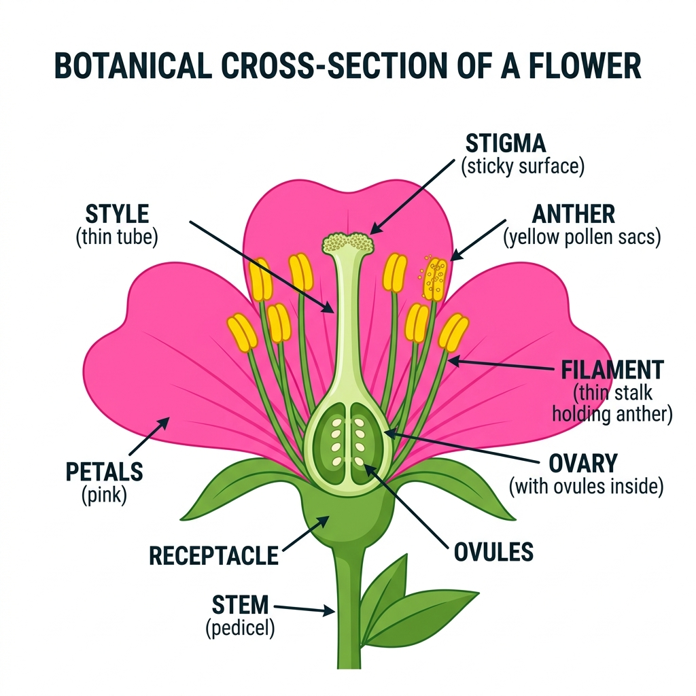
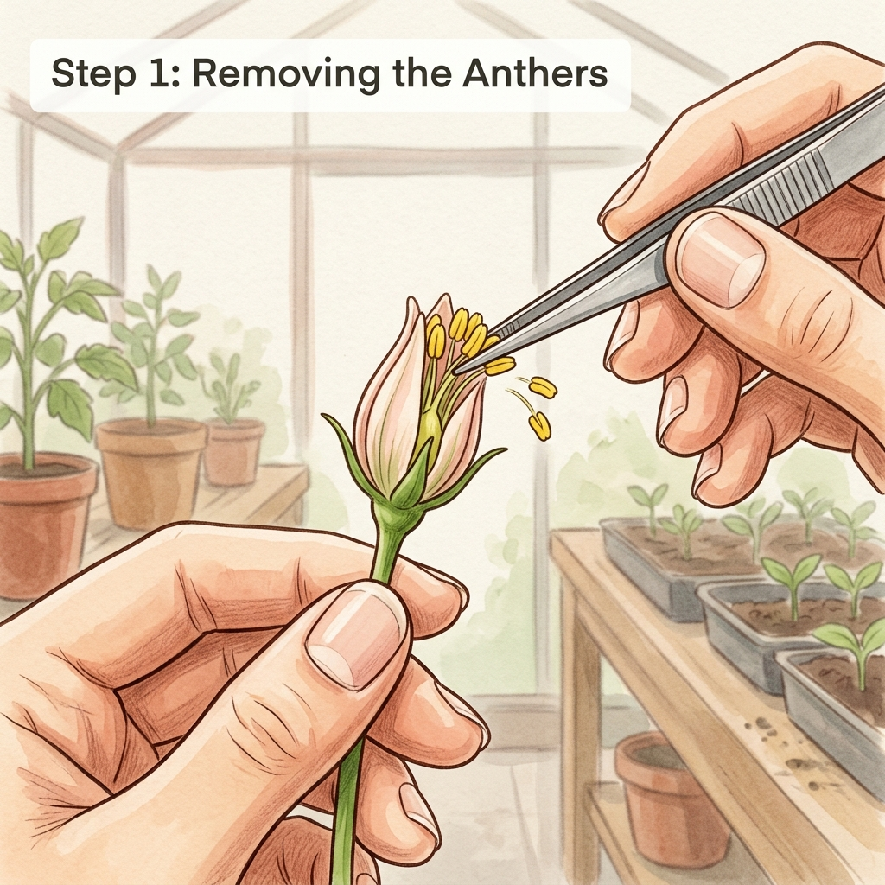
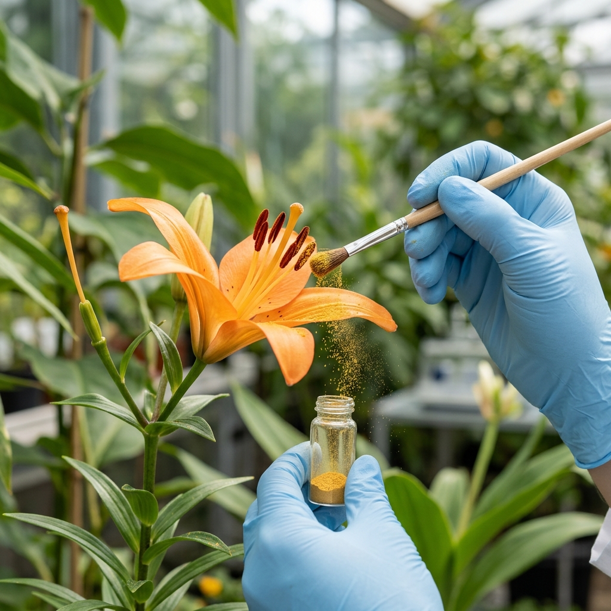
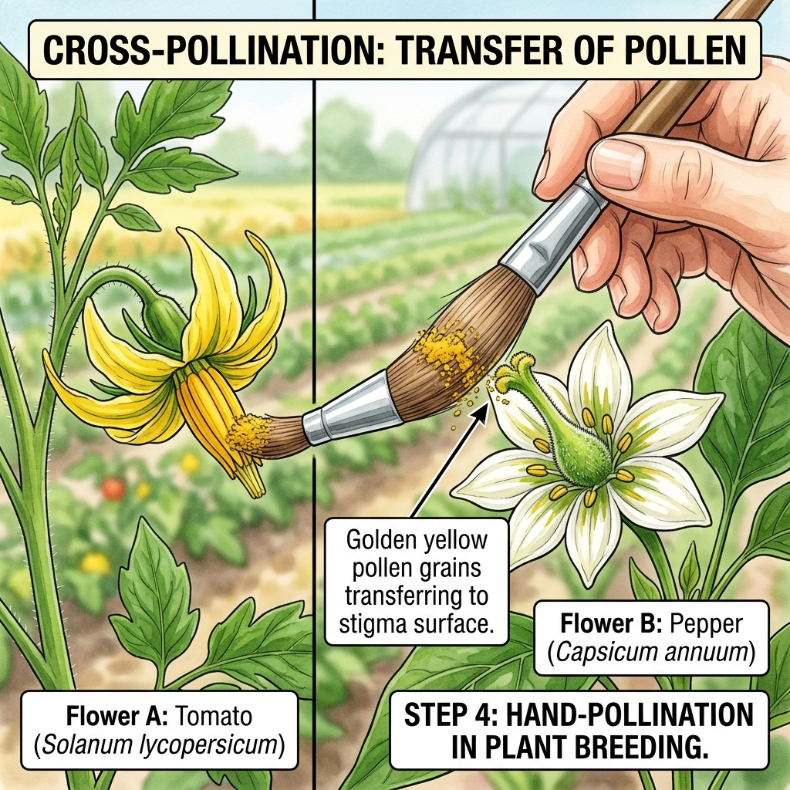
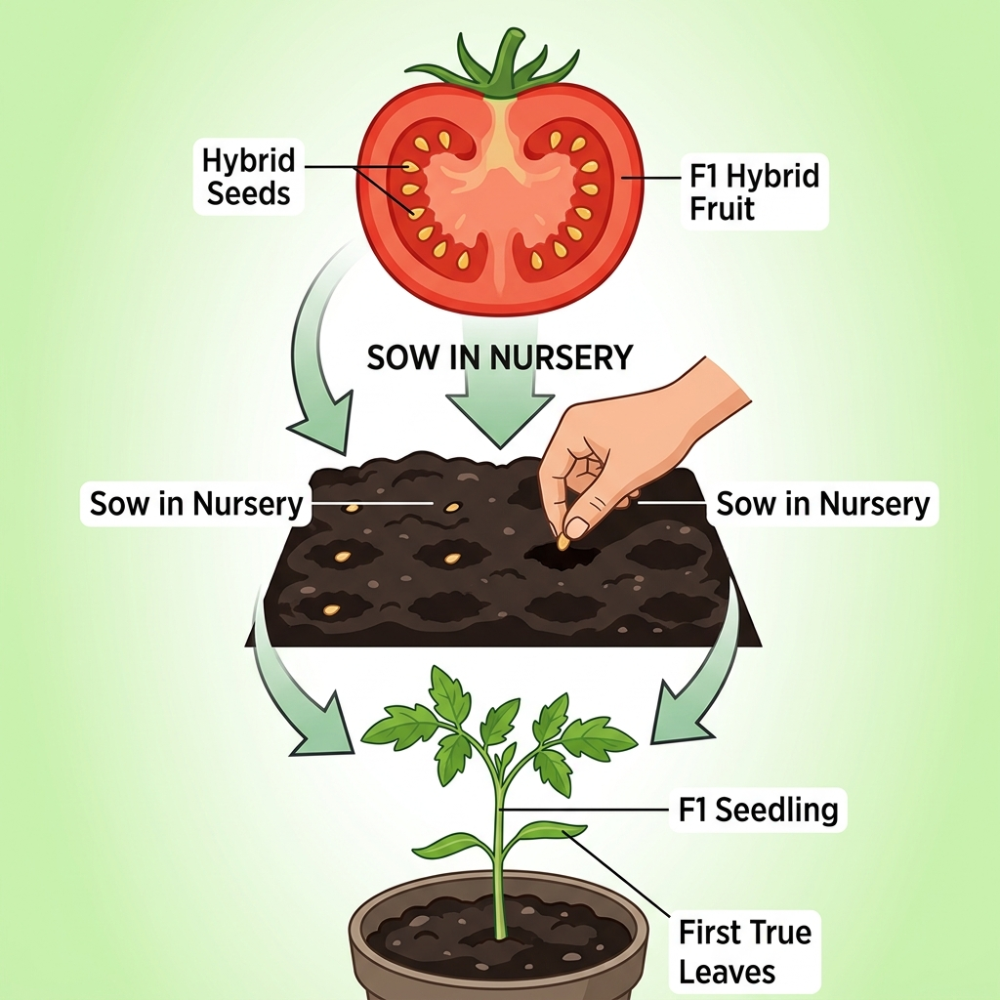
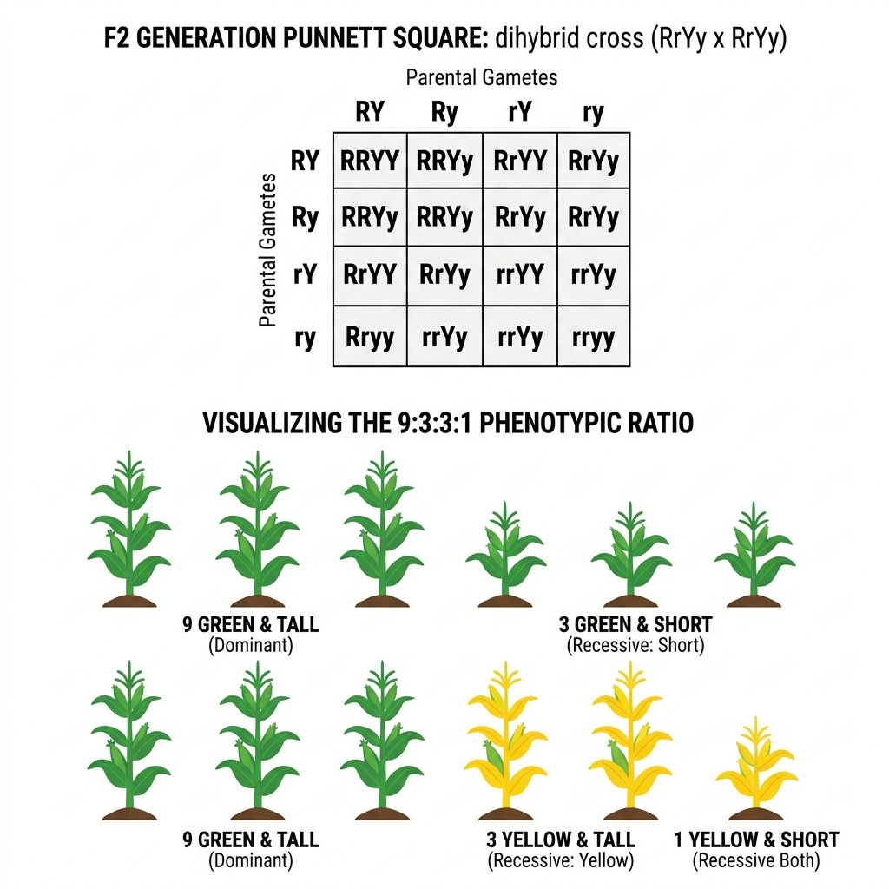
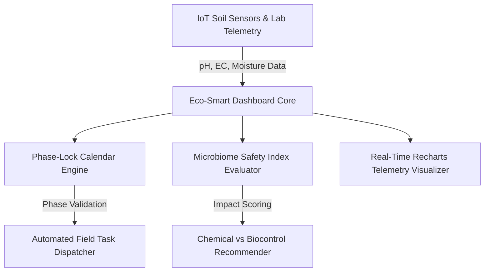

# Eco-Smart Agritech Platform

[](https://react.dev/)
[](https://vitejs.dev/)
[](https://tailwindcss.com/)
[](https://www.framer.com/motion/)
[](https://recharts.org/)

An advanced precision agriculture telemetry dashboard designed for high-yield, biological crop stewardship. Combines real-time sensor analytics, a rigorous 4-phase locked crop management calendar, pathogen diagnostics, and microbiome safety scoring.

---

## Precision Breeding & Agronomic Protocols

| 1. Flower Anatomy | 2. Emasculation Stage | 3. Pollen Harvesting |
| :---: | :---: | :---: |
|  |  |  |

| 4. Cross Pollination | 5. Germination Protocol | 6. F2 Segregation Analysis |
| :---: | :---: | :---: |
|  |  |  |

---

## Key Engineering Capabilities

1. **Phase-Locked Field Calendar**:
   - Enforces a strict 4-phase agricultural protocol (Soil Preparation & Germination → Seedling & Rooting → Vegetative Growth → Yield & Harvest).
   - Downstream phases remain mathematically locked until foundational biological prerequisites (e.g. soil pH 6.0–6.8 verification, EC testing, and *Trichoderma* fungal shield inoculation) are satisfied.
2. **Microbiome Safety Index (MSI)**:
   - Evaluates chemical treatments and biopesticides against beneficial soil bacterial colonies, grading applications with safety ratings to preserve root biodiversity.
3. **Telemetry & Real-Time Sensors**:
   - Live interactive Recharts visualizations for soil volumetric water content (VWC), electrical conductivity (EC), ambient temperature, and humidity.
4. **Interactive Crop Diagnostics**:
   - Visual leaf anomaly analysis paired with corrective organic and microbiological intervention plans.

---

## System Architecture



---

## Directory Structure

```
eco-agritech/
├── src/
│   ├── assets/            # Static imagery and visual assets
│   ├── components/
│   │   ├── Advisory/      # Agronomic guidance and treatment cards
│   │   ├── BreedingLab/   # Seed selection and trait analysis
│   │   ├── Diagnostics/   # Pathogen & leaf anomaly identification
│   │   ├── FieldCalendar/ # 4-phase locked agricultural milestone manager
│   │   ├── Landing/       # Interactive platform overview & hero
│   │   ├── Layout/        # Modular responsive navigation & sidebars
│   │   └── common/        # Shared eco-themed design system components
│   ├── data/              # Agronomic domain data & sensor mock states
│   ├── hooks/             # Custom responsive & telemetry hooks
│   ├── App.jsx            # Core application state coordinator
│   ├── index.css          # Tailwind utilities & theme tokens
│   └── main.jsx           # React DOM root mounting
├── index.html             # HTML entry point
├── package.json           # Manifest & dependencies
└── vite.config.js         # Optimized Vite build bundler
```

---

## Getting Started

### Prerequisites
- **Node.js**: v18.0 or higher
- **npm** or **yarn**

### Installation

```bash
# Clone the repository
git clone https://github.com/vijayasaran-p/eco-smart-agritech.git
cd eco-smart-agritech

# Install frontend dependencies
npm install

# Start local development server with Hot Module Replacement (HMR)
npm run dev
```

Visit `http://localhost:5173` in your browser.

### Production Build

```bash
# Build optimized bundle for production
npm run build

# Preview production build locally
npm run preview
```

---

## License
MIT License. Authored and maintained by [Vijaya Saran P](https://github.com/vijayasaran-p).
